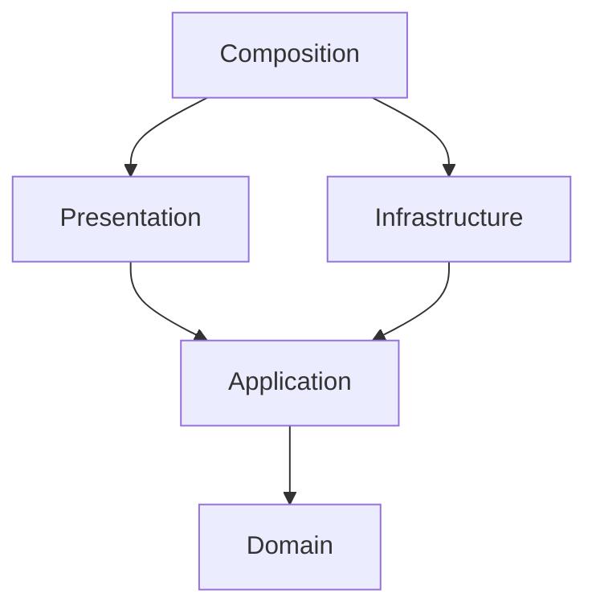

# Council Session context

Council Vote is a single-player logic puzzle: choose an agenda's three binary
clauses, predict five seats' public ballots and pass three councils in order.
M2 implements this contract as a pure domain (`src/council_vote/domain/model.py`);
M3 adds framework-independent use cases and SQLite persistence; the screen
follows in M4.

| Term | Meaning and planned model |
| --- | --- |
| Clause | Value identifying lamps, gate or bell; enabled or disabled. |
| Agenda | Immutable value containing the three clauses, with eight possible combinations. |
| Seat | Entity with stable identity and a public voting condition for this council. |
| Ballot | Value yes, no or abstain; each seat produces exactly one ballot per attempt. |
| Quorum | At least three non-abstaining ballots out of the five seats. |
| Tally | Immutable counts of yes, no and abstain, plus the derived approval result. |
| CouncilSession | Aggregate/entity owning identity, council index, attempts left and history. |
| AgendaResolved | Immutable event recording council, agenda, ballots, tally and outcome. |
| SessionEnded | Immutable event recording won or lost after the final resolution. |
| VoteCounter | Pure domain service: tally ballots and decide quorum and strict majority. |

An agenda passes only with quorum and more yes than no ballots. Abstentions count
toward neither quorum nor majority. A tie rejects the agenda. Examples: three yes,
one no and one abstain passes (four participating); two yes and three abstain
fails quorum; two yes, two no and one abstain has quorum but fails the majority.

A session starts at council one with two attempts. Each valid agenda resolution
consumes an attempt. Approval advances to the next council and resets attempts
to two; approval at council three ends the session as won. A rejected agenda
with no attempts left ends it as lost. Finished sessions reject further actions.
Invalid clauses or identities leave all state and history unchanged. Repeated
agendas are allowed and consume another attempt. Ballots are deterministic from
the council's public conditions and the agenda; there is no random voting.
The three fixed councils are committed below, and the tests enumerate all eight
agendas for each. Changing an agenda creates a new value.

## The three councils

A seat abstains when its abstaining condition holds; otherwise it votes yes when
its yes condition holds, and no when it does not.

### Council 1: Harbour Wardens

| Seat | Public condition |
| --- | --- |
| warden | yes if lamps on |
| pilot | yes if lamps on and gate on |
| chandler | yes if bell off |
| ferryman | abstains if bell on; otherwise yes if gate on |
| clerk | abstains if lamps off; otherwise always yes |

Passing agendas (clauses switched on): lamps; lamps, gate; lamps, gate, bell — 3 of 8.

### Council 2: Night Watch

| Seat | Public condition |
| --- | --- |
| captain | yes if bell on and gate off |
| lamplighter | abstains if lamps off and bell off; otherwise yes if lamps on |
| gatekeeper | yes if gate off |
| ringer | abstains if gate on and bell off; otherwise yes if bell on |
| recruit | abstains if lamps on and gate on; otherwise yes if lamps off |

Passing agendas (clauses switched on): bell; lamps, bell — 2 of 8.

### Council 3: Guild Elders

| Seat | Public condition |
| --- | --- |
| mason | yes if gate on and lamps off |
| weaver | abstains if lamps on and bell on; otherwise yes if lamps on and bell off |
| smith | abstains if gate off and bell off; otherwise yes if bell on |
| scribe | abstains if gate on and bell on; otherwise yes if lamps off and gate off |
| elder | yes if gate on and bell on |

Passing agendas (clauses switched on): gate, bell; lamps, gate, bell — 2 of 8.

No agenda passes all three councils, so each council has to be read on its own.

The **Council Session** bounded context owns agendas, seat conditions, ballots,
resolution and session completion. Real elections, personal identities, chat,
multiplayer, resource trading, territory, combat and external data are excluded.
The central decision is combining clauses under public predicates, quorum and a
majority rule. No secret role or guessing of another player's intent is required.

## Dependency direction

Domain uses the standard library. Application owns use cases and repository ports;
infrastructure implements them using Django ORM records and SQLite migrations.
Presentation translates Django forms, views and templates; composition alone
wires concrete adapters. ORM records are separate from domain aggregates.
Import Linter enforces inward dependencies, independent adapters and exclusion
of Django and sqlite3 from both core packages. Tests also import the core with
site packages disabled. Core code must not bypass contracts with dynamic imports.

## Roadmap and sources

1. M1: vocabulary, empty core packages, health route and verification.
2. M2 (done): values, aggregate, events, counter, fixed councils and pure rule tests.
3. M3 (done): start/resolve/read use cases, ORM repository, migrations and atomicity tests.
4. M4: one browser screen, public conditions, complete playthrough and actual screenshot.

Rules and architecture are project design choices, not claims mandated by Django.
Playable screens are deferred.
Official references checked 2026-11-06:

- [Django settings](https://docs.djangoproject.com/en/6.1/topics/settings/)
- [Django testing tools](https://docs.djangoproject.com/en/6.1/topics/testing/tools/)
- [Import Linter contracts](https://import-linter.readthedocs.io/en/stable/contract_types/)

A local gemma4:e4b draft supplied four vocabulary candidates. Ballot and quorum
were retained after checking the examples. Agenda was narrowed to the three
clauses, and tally was corrected to include abstentions. Drafts are not rule
authority; the explicit definitions and executable tests govern each milestone.
