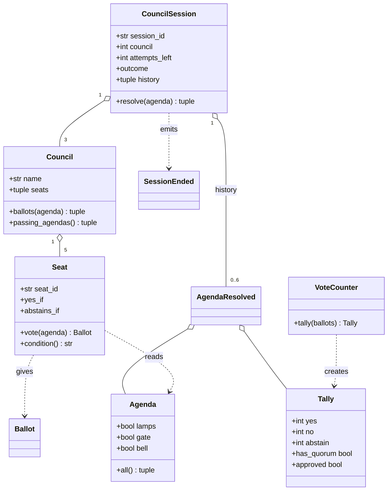
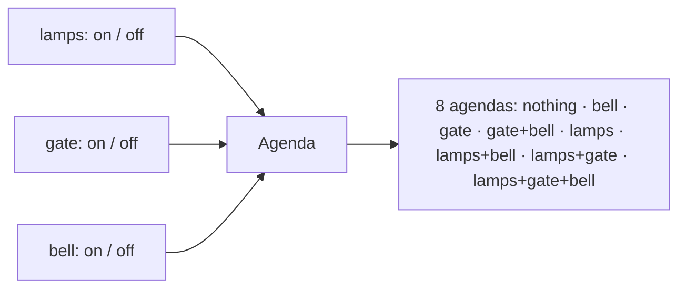
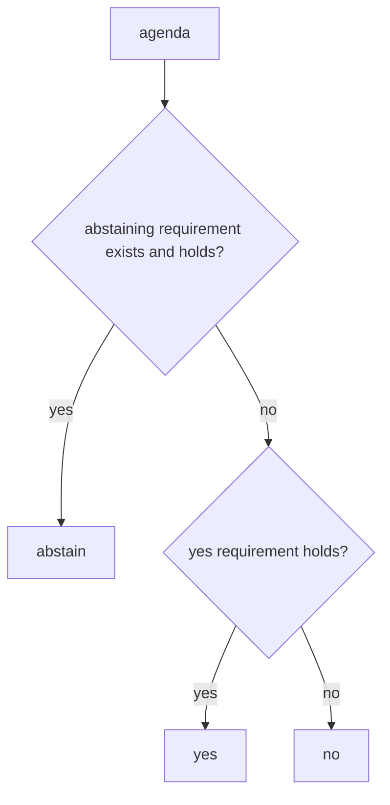
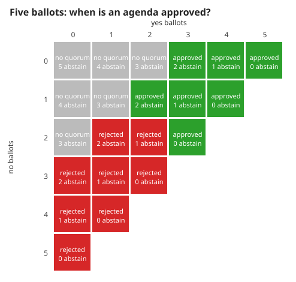
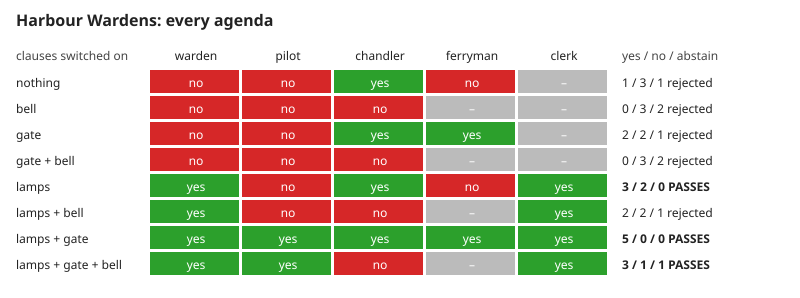
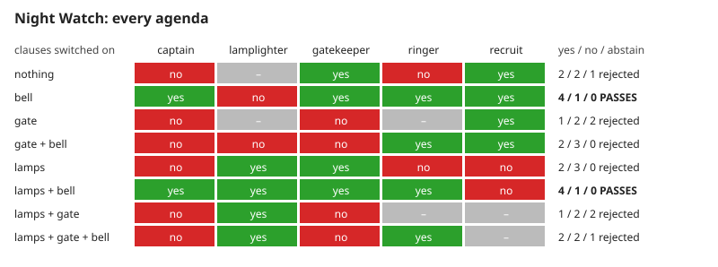
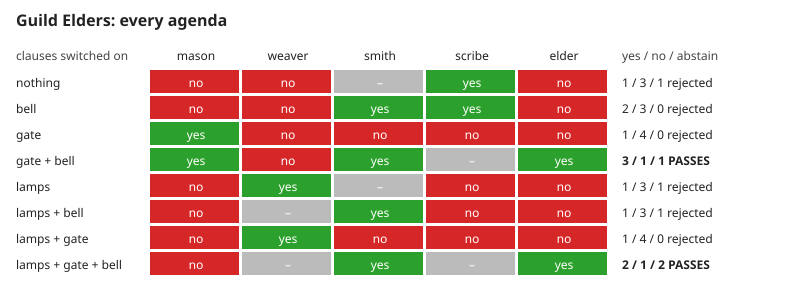

# 1. Voting: agendas, seats, counting and the three councils

A single-player logic puzzle: propose an agenda, and five seats vote on it by conditions that are public. Measured numbers are quoted by their id in [figures/values.md](figures/values.md).

[Back to the index](README.md)

## S01 — The language of the game

**Statement.** Ten terms, each with one meaning:

| Term | Meaning |
|---|---|
| Clause | one of three switches: lamps, gate, bell |
| Agenda | a setting of the three clauses, on or off |
| Seat | a council member with an identity and a public voting condition |
| Ballot | yes, no or abstain; a seat gives exactly one per agenda |
| Quorum | at least three ballots that are not abstentions |
| Tally | the counts of yes, no and abstain, and whether the agenda is approved |
| Council | five seats |
| CouncilSession | one game: which council is sitting, attempts left, everything resolved so far |
| AgendaResolved | the record of one proposal: council, agenda, ballots, tally, result |
| SessionEnded | the record that the game was won or lost |

**Assumptions and where they break.** One player; nothing is hidden and nothing is random. It is not a model of real elections.

**Derivation.** Definitions; the code uses the same words as class names, so that a sentence of the rules can be checked against one class.

**Code.** `src/council_vote/domain/model.py`: `Clause`, `Agenda`, `Ballot`, `Seat`, `Council`, `Tally`, `VoteCounter`, `CouncilSession`, `AgendaResolved`, `SessionEnded`, the union `Event`, `Outcome`, the exception `SessionFinished`, and the constants `QUORUM` = 3, `ATTEMPTS_PER_COUNCIL` = 2 and `COUNCILS`.

**Tests.** `test_REQ_SESSION_identity_is_required_and_history_records_the_ballots` in `tests/test_domain.py` builds these objects and compares them by value.

## S02 — An agenda: three switches, eight possibilities

**Statement.** An agenda is a triple (lamps, gate, bell) of truth values. There are $2^3 = 8$ agendas. An agenda is a value: two agendas with the same switches are equal, and changing a switch means making another agenda.

**Assumptions and where they break.** Each clause must be exactly `True` or `False`; 1, 0, text and "nothing" are refused, so a mistyped proposal cannot be read as a valid one.

**Derivation.** Three independent two-way choices.

**Code.** `Agenda.__post_init__`, `Agenda.enabled` and `Agenda.all` in `src/council_vote/domain/model.py`.

**Tests.** `test_REQ_AGENDA_values_are_exact_and_immutable`. Measured: `agendas` = 8; `agenda-rejected` = 4 of 4 non-boolean values.

## S03 — A seat's public condition decides its ballot

**Statement.** A seat has a *yes* requirement and, optionally, an *abstaining* requirement. A requirement is a list of clause states that must all hold (an empty list always holds). For an agenda the seat

1. abstains if it has an abstaining requirement and it holds;
2. otherwise votes yes if its yes requirement holds;
3. otherwise votes no.

So every seat gives exactly one ballot for every agenda, and the ballot depends on nothing but the agenda and the seat's public condition.

**Assumptions and where they break.** Requirements are conjunctions; a seat cannot say "lamps or gate". The order matters: a seat whose abstaining and yes requirements both hold abstains.

**Derivation.** The three cases are checked in a fixed order and the last has no condition, so exactly one applies.

**Code.** `Seat.vote`, `Seat.condition` (the wording shown to the player) and the helper `holds` in `src/council_vote/domain/model.py`.

**Tests.** `test_REQ_SEAT_public_condition_decides_one_ballot`, `test_REQ_COUNCIL_ballots_are_deterministic`. Measured over the `seats` = 15 seats and 8 agendas: always one ballot (`seat-one-ballot` = 1); `seat-abstainers` = 8 seats can abstain; whenever the abstaining requirement holds the ballot is an abstention (`seat-abstain-first` = 0 exceptions).

## S04 — Counting: quorum and a strict majority

**Statement.** With $y$ yes, $n$ no and $a$ abstentions among five ballots ($y + n + a = 5$), the agenda is **approved** exactly when

$$y + n \ge 3 \quad\text{(quorum)} \qquad\text{and}\qquad y > n \quad\text{(strict majority)} .$$

Abstentions count for neither. A tie is rejected. Two yes with three abstentions fails for lack of quorum, although nobody voted no.

**Assumptions and where they break.** Five seats and a quorum of three. The majority is of those taking part, not of all seats: three yes, two abstentions is approved.

**Derivation.** A design rule in the usual form for assemblies: a quorum of members present and voting, and more votes for than against [Robert 2020, §§40, 44].

**Code.** `VoteCounter.tally`, `Tally.participating`, `Tally.has_quorum`, `Tally.approved` in `src/council_vote/domain/model.py`.

**Tests.** `test_REQ_VOTE_quorum_and_strict_majority` (a hand-written table of ten cases) and `test_REQ_VOTE_every_split_of_five_follows_the_rule`. Measured over all `count-splits` = 243 ways five seats can vote: the counter never disagrees with the rule (`count-rule` = 0) and approves `count-approved` = 81 of them; `count-tie` = 0, `count-no-quorum` = 0, `count-three-one` = 1.

## S05 — The three councils

**Statement.** The game has three fixed councils of five seats. Of the eight agendas, 3 pass the Harbour Wardens, 2 pass the Night Watch and 2 pass the Guild Elders. No agenda passes all three, so a solution for one council cannot be reused for the next: each council has to be read.

**Assumptions and where they break.** The councils are data in the code, the same in every game. The numbers of passing agendas are found by enumeration, not asserted by design.

**Derivation.** For each council, apply S03 to each of the eight agendas and S04 to the five ballots. The three boards below are that computation, drawn by the program.

**Code.** `COUNCILS`, `Council.ballots` and `Council.passing_agendas` in `src/council_vote/domain/model.py`.

**Tests.** `test_REQ_COUNCIL_fixed_councils_have_a_passing_agenda_but_not_every` (enumerated independently of `passing_agendas`), `test_REQ_COUNCIL_five_distinct_seats`. Measured: `council-1-passing` = 3, `council-2-passing` = 2, `council-3-passing` = 2, `council-common` = 0.

## References

- H. M. Robert III et al., *Robert's Rules of Order Newly Revised*, 12th ed., PublicAffairs, 2020 — quorum and majority vote.
