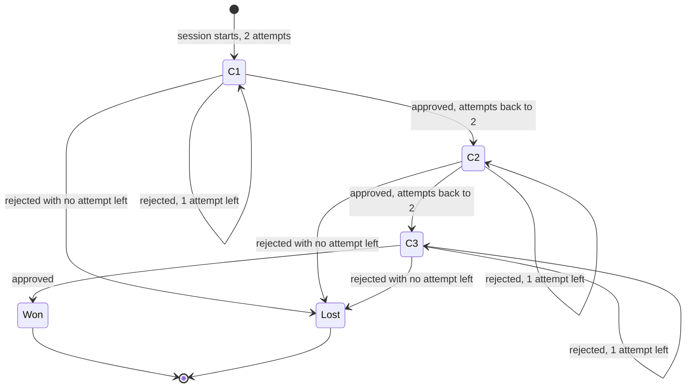
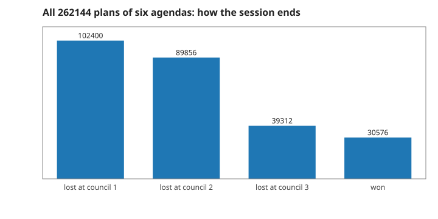
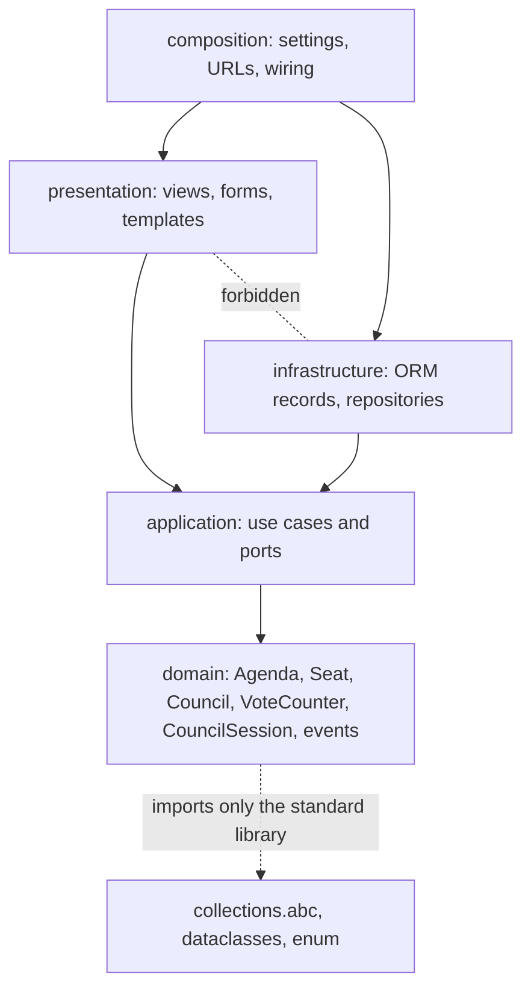

# 2. The session, its events, and where the rules live

How a game proceeds and ends, what each proposal records, and why the rules do not depend on Django. Measured numbers are quoted by their id in [figures/values.md](figures/values.md).

[Back to the index](README.md)

## S06 — The session: two attempts at each of three councils

**Statement.** A session starts at council 1 with two attempts. Each resolved agenda

- **approved**: move to the next council with two attempts again — or, at council 3, the session is **won**;
- **rejected**: one attempt fewer — and at zero the session is **lost**.

A finished session accepts nothing more. Proposing the same agenda again is allowed and costs another attempt. Six proposals always finish a session.

**Assumptions and where they break.** Attempts do not carry over between councils. There is no undo.

**Derivation.** A design rule. The longest game alternates a rejection and an approval three times: six proposals.



**Code.** `CouncilSession.resolve` and `CouncilSession.finished` in `src/council_vote/domain/model.py`; `ATTEMPTS_PER_COUNCIL`.

**Tests.** `test_REQ_SESSION_three_approvals_win`, `test_REQ_SESSION_a_rejection_costs_an_attempt_and_approval_restores_them`, `test_REQ_SESSION_two_rejections_lose_and_repeats_are_allowed`, `test_REQ_SESSION_losing_at_the_last_council`. Measured: `attempt-cost` = 1 attempt left after a rejection, `attempt-restored` = 2 after an approval; all `play-plans` = 262 144 plans of six agendas end in a finished session (`play-all-finish`).

## S07 — One proposal: validate, vote, count, record

**Statement.** `resolve(agenda)` does, in this order: refuse if the session is finished; refuse if the argument is not an Agenda; collect the five ballots (S03); count them (S04); record an `AgendaResolved`; update council, attempts and outcome (S06); and return the events — `AgendaResolved`, followed by `SessionEnded` when the game has just ended. A refused call changes nothing: **an invalid proposal consumes no attempt**.

**Assumptions and where they break.** The history only grows. The events hold everything that happened — council, agenda, all five ballots, the tally — so a screen can be drawn from them alone.

**Derivation.** A design rule: every check happens before the first change, so there is no half-applied proposal to undo.

```mermaid
sequenceDiagram
    participant P as caller
    participant S as CouncilSession
    participant C as Council
    participant V as VoteCounter
    P->>S: resolve(agenda)
    alt session finished
        S-->>P: SessionFinished (nothing changed)
    else not an Agenda
        S-->>P: TypeError (no attempt consumed)
    else
        S->>C: ballots(agenda)
        C-->>S: five ballots
        S->>V: tally(ballots)
        V-->>S: Tally
        S->>S: append AgendaResolved; advance or use an attempt
        S-->>P: (AgendaResolved[, SessionEnded])
    end
```

**Code.** `CouncilSession.resolve` and the dataclasses `AgendaResolved` and `SessionEnded` in `src/council_vote/domain/model.py`.

**Tests.** `test_REQ_SESSION_finished_sessions_reject_and_do_not_change` and `test_REQ_SESSION_invalid_agenda_changes_nothing` (the session equals a deep copy taken before). Measured: the losing resolution returns `events-on-loss` = 2 events; a finished session refuses (`finished-refuses` = 1) and its history stays at `finished-history` = 2; a proposal that is not an Agenda leaves `invalid-free` = 2 attempts.

## S08 — Nothing is random: guessing loses, reading wins

**Statement.** The ballots are a function of the council and the agenda, so the same proposals always give the same game. A player who picks agendas at random wins with probability

$$\prod_{k=1}^{3}\left[1 - (1 - p_k)^2\right] = 0.117, \qquad p = \left(\tfrac38, \tfrac28, \tfrac28\right),$$

where $p_k$ is the fraction of agendas that pass council $k$ (S05). A player who reads the public conditions wins every game in three proposals.

**Assumptions and where they break.** "At random" means each proposal uniform over the eight agendas, repeats allowed. The formula treats the two attempts at a council as independent, which holds for that player.

**Derivation.** At council $k$ the random player fails both attempts with probability $(1 - p_k)^2$; the councils are independent. The figure does not use the formula: it plays all $8^6$ plans of six agendas through the aggregate and counts.



**Code.** `Council.ballots` (no state, no random number) and `CouncilSession.resolve` in `src/council_vote/domain/model.py`.

**Tests.** `test_REQ_SESSION_every_pair_of_first_moves_is_reproducible`, `test_REQ_COUNCIL_ballots_are_deterministic`. Measured: `play-win-chance` = 0.11663818, equal to the formula to 8 digits; `play-lost-1` = 102 400, `play-lost-2` = 89 856, `play-lost-3` = 39 312, `play-won` = 30 576; the informed player wins in three (`play-informed` = 1).

## S09 — The rules do not know about Django

**Statement.** The code is in four layers, and imports point inward only:

$$\text{composition} \;\to\; \{\text{presentation},\ \text{infrastructure}\} \;\to\; \text{application} \;\to\; \text{domain} .$$

Presentation and infrastructure do not import each other. The domain and the application import neither Django nor sqlite3; the domain uses the standard library only.

**Assumptions and where they break.** The rule is about import statements; the second test below, which imports the core with third-party packages unavailable, also catches an import hidden inside a function for packages outside the standard library.

**Derivation.** If the rules import nothing from the outer layers, they can be run, tested and reasoned about without a server or a database — every number in this handbook was produced that way — and the framework or the storage can change without touching them [Evans 2003, ch. 4; Martin 2017, ch. 22].



**Code.** The two Import Linter contracts in `pyproject.toml` (`Adapters point inward and remain independent`, `Core excludes Django and direct database access`); `src/council_vote/domain/__init__.py` exports the sixteen names of S01.

**Tests.** `make check` runs Import Linter (2 contracts kept); `test_REQ_CORE_imports_without_frameworks` in `tests/test_scaffold.py` starts Python with site packages disabled and imports the domain and the application.

## References

- E. Evans, *Domain-Driven Design*, Addison-Wesley, 2003.
- R. C. Martin, *Clean Architecture*, Prentice Hall, 2017.
