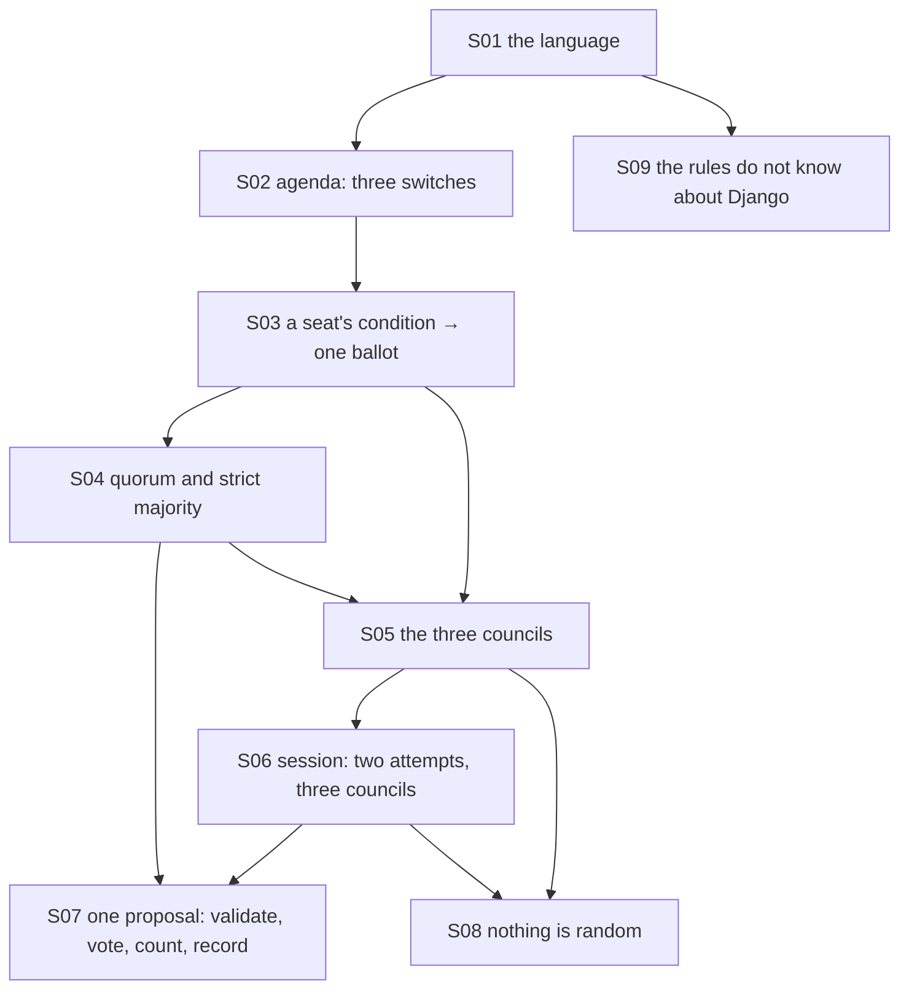

# Theory handbook

Why the program is correct, from the repository alone: every rule and invariant the code relies on, each stated in Markdown **with a figure**, the place in the code that implements it, and the test or measurement that checks it.

- Drawn figures and the numbers quoted in the text are produced by the domain itself: `make theory-figs` rewrites [figures/](figures/) and [figures/values.md](figures/values.md) (about 4 s; it plays all 262 144 plans of six agendas). Diagrams are Mermaid, written in the pages.
- `make theory-check` fails when a statement has no figure, a link is broken, a referenced function, test or measured value no longer exists, or a name exported by the domain is missing from the table below.

## Pages

1. [Voting: agendas, seats, counting and the three councils](01-voting.md) — the language, the agenda value, a seat's condition, quorum and majority, the three boards
2. [The session, its events, and where the rules live](02-session-and-layers.md) — attempts and endings, one proposal step by step, determinism and the chance of guessing, the dependency rule

## How the pieces depend on each other

## Coverage: statement → page → figure → code → test

| ID | Statement | Page | Figure | Code | Test |
|---|---|---|---|---|---|
| S01 | The language of the game | [1](01-voting.md) | mermaid | `src/council_vote/domain/model.py#Clause`, `src/council_vote/domain/model.py#Ballot`, `src/council_vote/domain/model.py#Outcome`, `src/council_vote/domain/model.py#Event`, `src/council_vote/domain/model.py#SessionFinished`, `src/council_vote/domain/model.py#AgendaResolved`, `src/council_vote/domain/model.py#SessionEnded` | `tests/test_domain.py#test_REQ_SESSION_identity_is_required_and_history_records_the_ballots` |
| S02 | An agenda: three switches, eight possibilities | [1](01-voting.md) | mermaid | `src/council_vote/domain/model.py#Agenda` | `tests/test_domain.py#test_REQ_AGENDA_values_are_exact_and_immutable` |
| S03 | A seat's public condition decides one ballot | [1](01-voting.md) | mermaid | `src/council_vote/domain/model.py#Seat`, `src/council_vote/domain/model.py#def holds` | `tests/test_domain.py#test_REQ_SEAT_public_condition_decides_one_ballot` |
| S04 | Quorum of three and a strict majority | [1](01-voting.md) | `figures/counting.svg` | `src/council_vote/domain/model.py#VoteCounter`, `src/council_vote/domain/model.py#Tally`, `src/council_vote/domain/model.py#QUORUM` | `tests/test_domain.py#test_REQ_VOTE_quorum_and_strict_majority`, `tests/test_domain.py#test_REQ_VOTE_every_split_of_five_follows_the_rule` |
| S05 | The three councils; 3, 2 and 2 passing agendas | [1](01-voting.md) | `figures/council-1.svg`, `figures/council-2.svg`, `figures/council-3.svg` | `src/council_vote/domain/model.py#COUNCILS`, `src/council_vote/domain/model.py#Council` | `tests/test_domain.py#test_REQ_COUNCIL_fixed_councils_have_a_passing_agenda_but_not_every` |
| S06 | The session: two attempts at each of three councils | [2](02-session-and-layers.md) | mermaid | `src/council_vote/domain/model.py#CouncilSession`, `src/council_vote/domain/model.py#ATTEMPTS_PER_COUNCIL` | `tests/test_domain.py#test_REQ_SESSION_three_approvals_win`, `tests/test_domain.py#test_REQ_SESSION_two_rejections_lose_and_repeats_are_allowed` |
| S07 | One proposal: validate, vote, count, record | [2](02-session-and-layers.md) | mermaid | `src/council_vote/domain/model.py#def resolve` | `tests/test_domain.py#test_REQ_SESSION_finished_sessions_reject_and_do_not_change`, `tests/test_domain.py#test_REQ_SESSION_invalid_agenda_changes_nothing` |
| S08 | Nothing is random: guessing wins 11.7 %, reading always | [2](02-session-and-layers.md) | `figures/random-play.svg` | `src/council_vote/domain/model.py#def ballots` | `tests/test_domain.py#test_REQ_SESSION_every_pair_of_first_moves_is_reproducible`, `scripts/theory_figs.py#play-win-chance` |
| S09 | Layers and the inward dependency rule | [2](02-session-and-layers.md) | mermaid | `pyproject.toml#Adapters point inward and remain independent` | `tests/test_scaffold.py#test_REQ_CORE_imports_without_frameworks` |

Tests named `scripts/theory_figs.py#…` are measurements recorded in [figures/values.md](figures/values.md) by `make theory-figs`, not assertions of `make check`.

## Reading the source against this table

Reviewed for this handbook: all of `src/council_vote/domain/model.py` (the sixteen names exported by `src/council_vote/domain/__init__.py`), the two Import Linter contracts in `pyproject.toml`, and `tests/test_domain.py`. The application, infrastructure and presentation packages hold no rules yet (M3, M4).

The program is unchanged by this handbook: it adds `scripts/theory_figs.py`, `scripts/theory_check.py`, two Makefile targets, one Ruff per-file setting and these pages.
